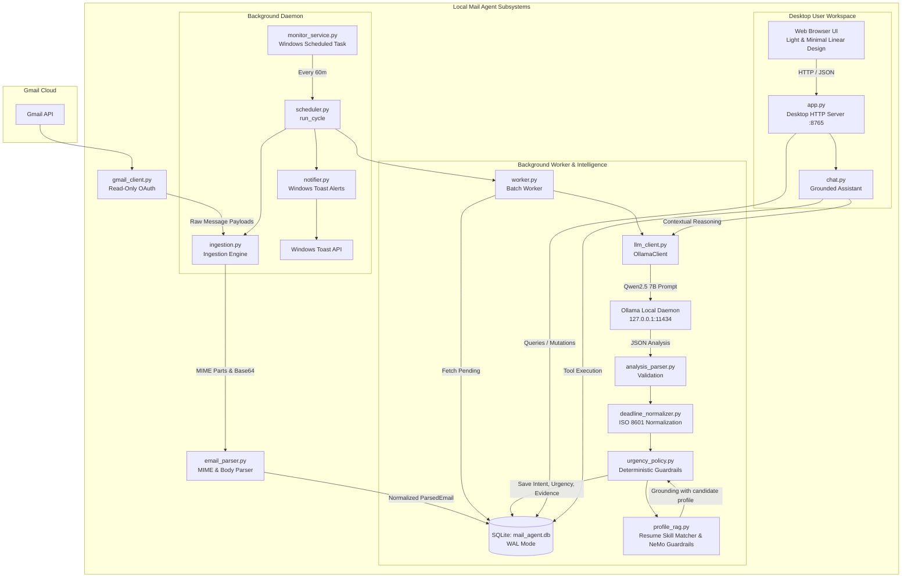

# Local Mail Agent — Full Project Walkthrough

An autonomous, privacy-first personal AI email assistant running 100% locally on Windows. It synchronizes incoming emails via read-only Gmail OAuth, performs structured semantic intelligence and deadline normalization using a local LLM (**Qwen2.5 7B** via Ollama), enforces deterministic priority and spam policies, dispatches selective Windows toast alerts, and provides a **Premium Light & Minimal** desktop web workspace with a grounded conversational AI assistant.

---

## Table of Contents

1. [System Architecture & Design Principles](#1-system-architecture--design-principles)
2. [End-to-End Pipeline & Module Breakdown](#2-end-to-end-pipeline--module-breakdown)
   - [Phase 1: Ingestion & MIME Parsing](#phase-1-ingestion--mime-parsing)
   - [Phase 2: Semantic Analysis & Deadline Extraction](#phase-2-semantic-analysis--deadline-extraction)
   - [Phase 3: Deterministic Priority & Urgency Policy](#phase-3-deterministic-priority--urgency-policy)
   - [Phase 4: SQLite Storage & Concurrency Locks](#phase-4-sqlite-storage--concurrency-locks)
   - [Phase 5: Notification & Alert Dispatcher](#phase-5-notification--alert-dispatcher)
   - [Phase 6: Independent Background Scheduler (60m)](#phase-6-independent-background-scheduler-60m)
   - [Phase 7: Grounded Conversational AI Assistant](#phase-7-grounded-conversational-ai-assistant)
   - [Phase 8: Desktop Web Interface & API](#phase-8-desktop-web-interface--api)
3. [Quickstart & Operations Guide](#3-quickstart--operations-guide)
   - [Installation & Prerequisites](#installation--prerequisites)
   - [Gmail Read-Only Authentication](#gmail-read-only-authentication)
   - [Running the Desktop Web Application](#running-the-desktop-web-application)
   - [Managing the Background Monitor (Windows Task Scheduler)](#managing-the-background-monitor-windows-task-scheduler)
   - [Command-Line Interface (CLI) Usage](#command-line-interface-cli-usage)
4. [API & Schema Reference](#4-api--schema-reference)
   - [SQLite Database Schema](#sqlite-database-schema)
   - [REST API Endpoints](#rest-api-endpoints)
5. [Automated Test Suite & Verification](#5-automated-test-suite--verification)

---

## 1. System Architecture & Design Principles

### Architectural Principles

1. **Local-First & Offline Resilience**: Email bodies, extracted metadata, embeddings, and analysis results are stored exclusively in a local SQLite database (`mail_agent.db`). No email data is sent to external cloud APIs or third-party inference providers. Conversation history in the assistant is session-scoped in-memory for user privacy and is deliberately not persisted to disk.
2. **Strict OAuth Permission Boundaries**: The default and required baseline scope is `https://www.googleapis.com/auth/gmail.readonly`. The agent cannot send emails, delete messages, or alter mailbox contents without explicit user consent. Optional Gmail read-state synchronization requires the user to explicitly grant `https://www.googleapis.com/auth/gmail.modify` and enable the setting in preferences; otherwise, the feature remains strictly disabled.
3. **Deterministic Safety over Pure LLM Generation**: LLMs can hallucinate urgency or fall for marketing buzzwords. Classification relies on a hybrid pipeline: Ollama extracts factual intent and literal evidence quotes, while deterministic Python rule policies govern priority thresholds, spam suppression, and notification routing.
4. **Independent Decoupled Processes**: The background monitor service operates autonomously in the background via Windows Task Scheduler. The desktop web app and CLI act as stateless inspection tools over the shared SQLite database.
5. **Separation of Local Intelligence and Cloud Synchronization**: Local parsing, classification, and persistence operate independently of cloud mutation. Local processing failure never alters cloud state, and cloud sync failure never causes redundant local LLM re-inference.

### System Diagram



---

## 2. End-to-End Pipeline & Module Breakdown

### Phase 1: Ingestion & MIME Parsing
 
- **[`gmail_client.py`](file:///d:/local-mail-agent/gmail_client.py)**:
  - Manages Google OAuth 2.0 flow using `credentials.json` and cached `token.json`.
  - Default scope: `https://www.googleapis.com/auth/gmail.readonly` (`GMAIL_READONLY_SCOPE`).
  - Supports optional `https://www.googleapis.com/auth/gmail.modify` (`GMAIL_MODIFY_SCOPE`) with `has_modify_permission()` and `mark_as_read(message_id)` removing `UNREAD` labels with 404 idempotent safety.
  - Queries recent messages (`newer_than:7d` or checkpoint overlap with `after:<epoch>`), fetches full message payloads, threads, and attachments safely.
- **[`ingestion.py`](file:///d:/local-mail-agent/ingestion.py)**:
  - Discovers new message IDs, compares them against stored IDs in `mail_agent.db`, and ingests only unseen emails (`INSERT OR IGNORE`).
  - Implements checkpoint-aware query builder `build_sync_query(checkpoint, include_unread=False)` with a 300-second overlap window to eliminate boundary-skipping.
  - Implements startup catch-up query `build_startup_catchup_query(checkpoint)` combining checkpoint overlap with `OR is:unread` to discover messages accumulated during extended laptop downtime or long network outages.
  - Advances sync checkpoints in `sync_checkpoints` only upon complete, error-free pagination.
- **[`email_parser.py`](file:///d:/local-mail-agent/email_parser.py)**:
  - Recursively traverses MIME multipart trees (`_walk_parts`).
  - Decodes `base64url` body payloads.
  - Prioritizes plain-text bodies; strips HTML safely via `_HTMLTextExtractor` when plain text is absent.
  - Normalizes headers (Sender, Subject, Date) and parses attachment metadata (filename, MIME type, size, attachment ID).

---

### Phase 2: Semantic Analysis & Deadline Extraction

- **[`llm_client.py`](file:///d:/local-mail-agent/llm_client.py)**:
  - Interfaces with the local Ollama instance at `http://127.0.0.1:11434/api/generate`.
  - Default model: `qwen2.5:7b` (configured with temperature `0.1` and a `600s` generation timeout to accommodate deep reasoning and prompt complexity).
- **[`email_analyzer.py`](file:///d:/local-mail-agent/email_analyzer.py)**:
  - Constructs a grounded prompt asking the LLM to output pure JSON according to Schema Version `2.0.0`:
    1. `intent` (interview invitation, scheduling, confirmation, job opportunity, hackathon, competition, promotional, newsletter, uncertain)
    2. `importance` (critical, high, normal, low)
    3. `summary` (1-2 factual sentences)
    4. `deadline` (raw deadline string or null)
    5. `recommended_action` (concrete next step)
    6. `evidence` (literal verbatim text snippets extracted from the email body)
- **[`analysis_parser.py`](file:///d:/local-mail-agent/analysis_parser.py)**:
  - Strips markdown code fences (````json ... ````), extracts and validates the JSON structure against the Pydantic model [`schemas.EmailAnalysis`](file:///d:/local-mail-agent/schemas.py) (backward compatible with legacy schema fields).
- **[`deadline_normalizer.py`](file:///d:/local-mail-agent/deadline_normalizer.py)**:
  - Converts unstructured dates (*"tomorrow at 5 PM"*, *"by Friday Oct 16"*, *"in 24 hours"*) into explicit, timezone-aware UTC ISO-8601 timestamps relative to the email's `received_at` timestamp.

---

### Phase 3: Deterministic Priority & Urgency Policy

- **[`urgency_policy.py`](file:///d:/local-mail-agent/urgency_policy.py)**:
  - Protects users from LLM hallucination and promotional spam masquerading as high-importance emails:
    1. **Genuine Interview Guard**: Verified interview outreach is promoted to `high` or `critical` importance and marked `not_spam`.
    2. **Job Tracking & Promotional Noise Suppression**: Advertisements for job boards, profile views, webinars, discounts, or automated alerts are classified as `promotional` / `suspected_spam` and suppressed from the Smart Inbox.
    3. **Rejection Handling**: Job rejections are marked `low` importance with `requires_action = False`.
    4. **Mathematical Urgency Calculation**:
       - `deadline <= 24 hours` $\rightarrow$ **Urgent**
       - `deadline <= 72 hours` $\rightarrow$ **High**
       - `deadline > 72 hours` $\rightarrow$ **Normal**
       - `requires_action == False` $\rightarrow$ **Low**

---

### Phase 4: SQLite Storage & Concurrency Locks

- **[`storage.py`](file:///d:/local-mail-agent/storage.py)**:
  - Direct connection manager for `mail_agent.db` with SQLite **WAL (Write-Ahead Logging)** mode enabled for concurrent reads and writes.
  - Stores emails, analyses, sync checkpoints, service statuses, application settings (`app_settings`), and distributed locks.
  - Automatically applies idempotent schema migrations for read-state synchronization (`gmail_read_sync_status`, `gmail_read_sync_attempted_at`, `gmail_read_sync_error_type`, `gmail_read_sync_retry_count`).
  - Implements atomic leases in `worker_locks` to prevent race conditions between the desktop app, background monitor, and chatbot.
  - Provides thread and full-text search queries.

---

### Phase 5: Notification & Alert Dispatcher

- **[`notifier.py`](file:///d:/local-mail-agent/notifier.py)**:
  - Dispatches native Windows Toast notifications via PowerShell / WinRT APIs.
  - **Selective Alerting Policy**: Toast alerts trigger *only* for emails that are genuine interviews, approaching deadlines, or urgent opportunities that have not previously been notified.
  - **Robust Deep-Linking**: Embeds deep links (`http://localhost:8765/?email=<message_id>`) into the notification toast.
  - **Deep-Link Navigation Handling**: When opened in [`app.py`](file:///d:/local-mail-agent/app.py):
    1. Validates and parses the `?email=` query parameter before initial list rendering.
    2. Matches the target email across all records.
    3. Automatically adjusts the active navigation filter (e.g., switches to "All Mail" or the email's specific category) if the target message is outside the default view.
    4. Selects the exact message and loads the reading pane.
    5. Scrolls the email card into visible viewport.
    6. Prevents periodic 20-second automatic polling refreshes from overriding the user's active selection.

---

### Phase 6: Background Scheduler, Startup Catch-Up & Read-State Sync

- **[`scheduler.py`](file:///d:/local-mail-agent/scheduler.py)**:
  - Implements `run_startup_cycle()`: executes immediately upon monitor launch. Acquires the process lock, verifies local DB and OAuth scopes, checks Ollama connectivity, recovers stale processing records, fetches accumulated unread emails with `build_startup_catchup_query()`, runs local analysis, executes eligible Gmail read-state syncs, and dispatches notifications.
  - Implements `run_cycle()`: steady-state hourly cycle executing ingestion $\rightarrow$ worker classification $\rightarrow$ read-state sync $\rightarrow$ notification dispatching.
  - Implements `run_forever()`: loops indefinitely every 3600 seconds (60 minutes) with interruptible wait events.
- **[`monitor_service.py`](file:///d:/local-mail-agent/monitor_service.py)**:
  - Entry point for the background monitor process, launched via Windows Task Scheduler.
  - Runs `run_startup_cycle()` on startup before entering the steady-state hourly loop.
  - Holds an active process lease lock with an auto-renewing heartbeat thread every 30 seconds.
- **[`setup_monitor_task.ps1`](file:///d:/local-mail-agent/setup_monitor_task.ps1)**:
  - Configures Windows Task Scheduler task `LocalMailAgent-BackgroundMonitor`.
  - Runs at user logon (`-AtLogOn`) with automatic restart and on-battery execution enabled.
- **Gmail Read-State Synchronization**:
  - **Safety Policy**: Message is eligible for Gmail read modification *only* after local processing is completely finished (`status = 'completed'`), validated, and persisted to SQLite.
  - **Default Disabled**: Controlled by `mark_as_read_enabled` in `app_settings` (defaults to `false`).
  - **Scope Isolation**: Requires explicit opt-in and OAuth authorization for `https://www.googleapis.com/auth/gmail.modify`. If only read-only scope is present, read-state sync is safely skipped with a diagnostic notice.
  - **Bounded Retries & Idempotency**: Failed Gmail modifications retry up to 3 times without re-running expensive LLM inferences. Already-read messages and 404 responses are handled cleanly without error escalation.

---

### Phase 7: Grounded Conversational AI Assistant

- **[`chat.py`](file:///d:/local-mail-agent/chat.py)** & **[`tools.py`](file:///d:/local-mail-agent/tools.py)**:
  - Provides a tool-augmented conversational assistant grounded in local database records.
  - **Session-Scoped Privacy**: Conversation history is maintained strictly in-memory per browser session and is deliberately not saved across browser refreshes or persisted to SQLite for personal privacy.
  - Registered Database Tools:
    - `search_local_emails`: Full-text search over subjects, senders, and summaries.
    - `get_email_details`: Full metadata and body lookup for an email.
    - `get_upcoming_deadlines`: Queries unacknowledged emails with deadlines ordered by proximity.
    - `get_pending_actions`: Lists emails requiring response.
    - `find_interviews`: Filters verified interview rounds and screenings.
    - `find_opportunities`: Retrieves hackathons, competitions, and job opportunities.
    - `inspect_suppressed_promotions`: Inspects suppressed spam/promotions.
    - `get_thread_context`: Retrieves all messages in a thread chain.
    - `explain_email_decision`: Returns evidence quotes and policy rules for a specific email.
    - `refresh_gmail_messages`: Performs a live read-only sync with Gmail.
  - **Resume RAG & Personal Context Injection**:
    - Grounded in verified candidate facts from [`data/profile/user_profile.json`](file:///d:/local-mail-agent/data/profile/user_profile.json) via [`profile_rag.py`](file:///d:/local-mail-agent/profile_rag.py).
    - When drafting replies to competitions, hackathons, or recruiter inquiries, automatically retrieves matching accomplishments (e.g., Smart India Hackathon, SSN Hackathon Top 4, Amazon ML Challenge Top 100), relevant technical skills (PyTorch, Agentic AI, FastAPI), and degree information (B.E. CSE, National Engineering College).
  - **Output Guardrails Engine**:
    - **Truthfulness Guardrail**: Enforces strict grounding in verified profile facts; eliminates hallucinated credentials, fake companies, or guessed phone numbers.
    - **Formatting Guardrail**: Strips markdown code fences (````markdown````, ````), duplicate header leaks (`Subject:`, `To:`), and backticks.
    - **Verified Signature Guardrail**: Automatically formats an official professional sign-off with candidate name, college, email (`sdinesh2k06@gmail.com`), phone (`+91 63690 15600`), LinkedIn, and GitHub.
  - **Human-in-the-Loop Confirmation Gate**: When the agent drafts an email, it renders an interactive card in the chat interface displaying the draft details and a **[Confirm & Send]** action button. Messages are never sent autonomously without explicit human confirmation.

---

### Phase 8: Desktop Web Interface & API

- **[`app.py`](file:///d:/local-mail-agent/app.py)**:
  - Lightweight, zero-dependency Python `ThreadingHTTPServer` serving the single-page application.
  - Implements the **Premium Light & Minimal** design system:
    - Warm-white canvas (`#F8FAFC`), pure white surfaces (`#FFFFFF`), subtle neutral borders (`#E2E8F0`).
    - Dark slate text (`#0F172A`) with muted secondary text (`#64748B`).
    - Focused indigo interaction color (`#4F46E5`).
    - Inline SVG iconography with zero emoji dependencies.
  - Split-pane workspace:
    - **Navigation Sidebar**: Needs Attention, Interviews, Deadlines, Opportunities, Review Queue, Promotions/Spam, Handled, All Mail, Service Status.
    - **Email List Pane**: Compact, high-density stream with instant search, sorting (*Newest*, *Priority*, *Deadline*), and tag indicators.
    - **Adaptive Reading Panel**:
      - **Informational Emails**: Automatically elevates a prominent **AI Executive Briefing** while gracefully collapsing the raw email body inside an expandable `<details>` section to keep the reading pane clean and focused.
      - **Action-Required Emails**: Displays a high-contrast **Action Required Banner** highlighting the exact recommendation, target deadline, and a 1-click **[⚡ Draft Action Response]** button that immediately loads the AI drafting copilot.
      - **Contextual Job RAG Skills Banner**: For job opportunities from Naukri, LinkedIn, Unstop, or Devfolio, dynamically computes skill overlap with your verified resume profile (e.g. `🎯 Resume Skills Match: Python • AI/ML • FastAPI • PyTorch`) and displays match percentage.
    - **Contextual Job & Opportunity Intelligence**:
      - Evaluates incoming job alerts (Naukri, LinkedIn, Unstop, etc.) against candidate technical skills using word-boundary RAG analysis in [`profile_rag.py`](file:///d:/local-mail-agent/profile_rag.py).
      - Relevant roles are promoted to **Opportunities** (`spam_status = 'not_spam'`, `importance = 'high'`, `requires_action = True`).
      - Generic marketing upsells (e.g. "Buy FastForward booster", "Profile views summary") remain suppressed as promotional noise.
    - **AI Assistant View**: Conversational interface with context banner, quick prompts, data freshness badges (*Live Gmail Verified* vs. *Local SQLite Cache*), interactive database result cards, and editable reply drafts with clipboard copy.
    - **Service & Settings Modal**: Live background monitor heartbeat diagnostics, sync counters, and configuration controls for automated Gmail read-state synchronization with permission detection.

---

## 3. Quickstart & Operations Guide

### Installation & Prerequisites

1. **System Requirements**: Windows 10/11, Python 3.11+, and PowerShell.
2. **Package Manager**: Managed with `uv` (fast Python package and project manager).
3. **Install Local Ollama**:
   - Download and install [Ollama for Windows](https://ollama.com/).
   - Pull the recommended model:
     ```powershell
     ollama pull qwen2.5:7b
     ```
4. **Set Up Python Environment**:
   ```powershell
   cd D:\local-mail-agent
   uv sync
   ```

---

### Gmail OAuth Authentication

1. Place your Google Cloud OAuth client secret file at `D:\local-mail-agent\credentials.json`.
2. Run the authentication helper:
   ```powershell
   uv run python main.py auth
   ```
3. A browser window opens requesting read-only access (`https://www.googleapis.com/auth/gmail.readonly`). Upon consent, `token.json` is saved locally.
4. **Optional Read-State Modification Scope**: If you choose to enable automated marking of messages as read in Gmail, explicit user authorization is required for `https://www.googleapis.com/auth/gmail.modify`.

---

### Running the Desktop Web Application

To launch the web interface:
```powershell
uv run python main.py app
```
The server will start at **`http://localhost:8765/`** and automatically open in your default browser.

---

### Managing the Background Monitor (Windows Task Scheduler)

The background monitor runs autonomously on machine startup (`-AtLogOn`) and recurs every 60 minutes.

| Action | PowerShell Command |
| :--- | :--- |
| **Check Live Status** | `powershell -ExecutionPolicy Bypass -File .\setup_monitor_task.ps1 -Action status` |
| **Install / Register Task** | `powershell -ExecutionPolicy Bypass -File .\setup_monitor_task.ps1 -Action install` |
| **Trigger Immediate Run** | `powershell -ExecutionPolicy Bypass -File .\setup_monitor_task.ps1 -Action run` |
| **Uninstall Task** | `powershell -ExecutionPolicy Bypass -File .\setup_monitor_task.ps1 -Action uninstall` |
| **CLI Status Check** | `uv run python main.py status` |

---

### Command-Line Interface (CLI) Usage

The application provides a CLI for scripting and headless operation:

```powershell
# Check background service status and next sync time
uv run python main.py status

# Manually trigger a Gmail sync
uv run python main.py sync --max-results 10

# Run AI classification on pending messages
uv run python main.py classify --limit 5

# List high-priority / actionable emails
uv run python main.py list

# View full email details and AI analysis
uv run python main.py show <message_id>

# Mark an email as handled / acknowledged
uv run python main.py ack <message_id>

# Generate and print the daily digest
uv run python main.py digest
```

---

## 4. API & Schema Reference

### SQLite Database Schema

#### `emails` Table
Stores raw email content alongside normalized analysis and read-state synchronization:

| Column | Type | Description |
| :--- | :--- | :--- |
| `message_id` | `TEXT PRIMARY KEY` | Unique Gmail message identifier |
| `thread_id` | `TEXT` | Gmail conversation thread identifier |
| `sender` | `TEXT` | Sender display name and email address |
| `subject` | `TEXT` | Email subject line |
| `received_at` | `TEXT` | UTC ISO-8601 received timestamp |
| `body` | `TEXT` | Cleaned plain-text message body |
| `body_source` | `TEXT` | Extraction source (`plain`, `html`, `empty`) |
| `attachments` | `TEXT` | JSON array of attachment metadata |
| `category` | `TEXT` | Legacy category (`job`, `hackathon`, `other`) |
| `intent` | `TEXT` | High-fidelity intent classification |
| `importance` | `TEXT` | `critical`, `high`, `normal`, `low` |
| `urgency` | `TEXT` | `urgent`, `high`, `normal`, `low` |
| `spam_status` | `TEXT` | `not_spam`, `suspected_spam`, `confirmed_spam` |
| `summary` | `TEXT` | Factual executive summary |
| `deadline` | `TEXT` | Normalized UTC ISO-8601 deadline timestamp |
| `requires_action`| `INTEGER` | `1` if action required, `0` otherwise |
| `recommended_action`| `TEXT`| Concrete next recommended step |
| `priority_reason`| `TEXT` | Deterministic explanation for priority |
| `evidence` | `TEXT` | JSON array of literal body excerpts |
| `notified_at` | `TEXT` | Timestamp when toast alert was dispatched |
| `acknowledged_at`| `TEXT` | Timestamp when user marked email as handled |
| `status` | `TEXT` | Processing state (`pending`, `completed`, `failed`) |
| `gmail_read_sync_status` | `TEXT` | Read-state sync status (`pending`, `completed`, `failed`, `disabled`) |
| `gmail_read_sync_attempted_at` | `TEXT` | UTC timestamp of last Gmail read modification attempt |
| `gmail_read_sync_error_type` | `TEXT` | Error reason if read synchronization failed |
| `gmail_read_sync_retry_count` | `INTEGER` | Retry attempt counter (bounded at 3) |

#### Auxiliary Tables
- **`app_settings`**: Persists key-value user preferences across restarts (`key PRIMARY KEY`, `value`, `updated_at`).
- **`sync_checkpoints`**: Stores the timestamp of the last successful Gmail ingestion.
- **`worker_locks`**: Implements time-limited distributed leases (`lock_name`, `owner_id`, `expires_at`).
- **`service_status`**: Tracks background service health, heartbeats, and error diagnostics.

---

### REST API Endpoints

Served by [`app.py`](file:///d:/local-mail-agent/app.py) on `http://localhost:8765`:

| Method | Endpoint | Description |
| :--- | :--- | :--- |
| `GET` | `/` | Serves the Light & Minimal desktop web application |
| `GET` | `/api/emails` | Returns all stored emails ordered by `received_at DESC` |
| `GET` | `/api/stats` | Returns counts for badges, sync status, and service health |
| `GET` | `/api/service_status` | Returns the background monitor service health record |
| `GET` | `/api/settings` | Returns persistent user settings (e.g. `mark_as_read_enabled`) |
| `GET` | `/api/thread?thread_id=...` | Returns all messages belonging to a conversation thread |
| `GET` | `/api/attachment?message_id=...` | Returns attachment metadata for a specific email |
| `GET` | `/api/digest` | Returns the formatted plain-text daily digest |
| `POST` | `/api/settings` | Updates persistent user settings |
| `POST` | `/api/chat` | Evaluates user query with database tools and returns grounded response |
| `POST` | `/api/sync` | Manually triggers a Gmail ingestion cycle |
| `POST` | `/api/classify` | Manually triggers AI classification for pending emails |
| `POST` | `/api/ack` | Marks an email as handled (`acknowledged_at = now`) |
| `POST` | `/api/unack` | Marks an email as pending (`acknowledged_at = NULL`) |
| `POST` | `/api/spam` | Suppresses an email as confirmed spam |
| `POST` | `/api/restore` | Restores a suppressed email back to the inbox |
| `POST` | `/api/reanalyze` | Re-evaluates an email with the local Qwen2.5 7B model |
| `POST` | `/api/send_email` | Human-confirmed endpoint to dispatch a created Gmail draft or new message |

---

## 5. Automated Test Suite & Verification

The codebase includes an automated regression test suite covering every subsystem.

To run the full test suite:
```powershell
uv run pytest -q
```

### Test Coverage Map

```text
test/
├── test_agent.py                   # Agent loop orchestration
├── test_analysis_parser.py         # JSON extraction and schema validation
├── test_app.py                     # HTTP handler and REST API endpoints
├── test_chat.py                    # Chat tool registry and execution
├── test_chatbot_gmail.py           # Gmail-aware tools and freshness tracking
├── test_deadline_normalizer.py     # Temporal parsing and ISO-8601 normalization
├── test_deep_link.py               # Toast deep-linking URL parsing and view selection
├── test_digest.py                  # Daily digest compilation
├── test_digest_job.py              # Digest execution job
├── test_draft_and_send.py          # Gmail draft creation & confirmed send workflow
├── test_e2e_workflow.py            # End-to-end ingestion -> analysis -> alert
├── test_email_analyzer.py          # LLM prompt construction and parsing
├── test_email_parser.py            # MIME multipart and HTML body decoding
├── test_gmail_client.py            # Read/write Gmail API client and read sync
├── test_gmail_read_sync.py         # Gmail read-state synchronization and settings
├── test_inbox.py                   # CLI inbox formatting and filtering
├── test_ingestion.py               # Ingestion idempotency, queries, and checkpoints
├── test_intelligence_evaluation.py  # Complex benchmark evaluations (interviews, hackathons)
├── test_llm_client.py              # Ollama client retry logic
├── test_loop.py                    # Step limits and agent loop safety
├── test_monitor_service.py         # Background monitor service and locks
├── test_notification_policy.py     # Notification filtering guardrails
├── test_notifier.py                # Windows Toast notification delivery
├── test_profile_rag.py             # Profile RAG retrieval and draft guardrails
├── test_retry.py                   # Exponential backoff utilities
├── test_scheduler.py               # Scheduler cycles and error envelopes
├── test_schemas.py                 # Pydantic data model validation
├── test_startup_catchup.py         # Startup catch-up, unread queries, and locks
├── test_state.py                   # State serialization
├── test_storage.py                 # SQLite WAL storage, indexes, and queries
├── test_task_scheduler.py          # Windows Task Scheduler command generators
├── test_tools.py                   # Tool registration and discovery
├── test_urgency_policy.py          # Deterministic priority and urgency rules
└── test_worker.py                  # Queue processing and retry limits
```

**Verification Status**: **302 passed** (100% pass rate) with zero warnings across 34 test modules.
